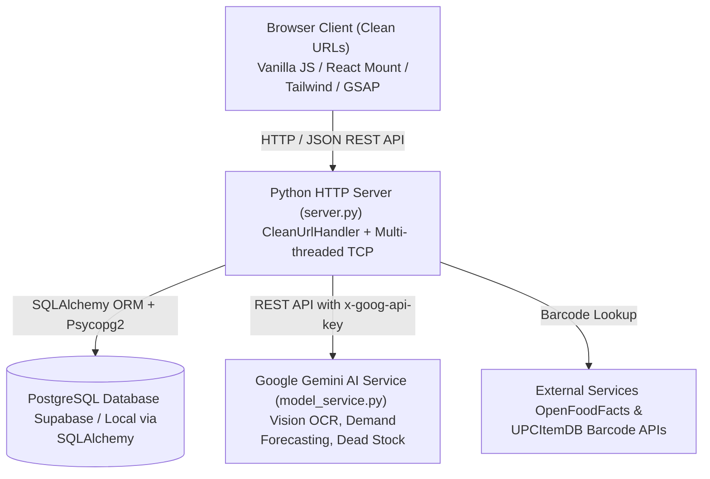

# Mercura AI — Smarter Inventory. Stronger Tomorrow.

> **"Driven by AI, controlled by you."**  
> An institutional-grade Working Capital & POS Ingestion Engine designed to transform dormant retail inventory into liquid working capital.

---

## 📌 Executive Summary

**Mercura AI** is an AI-driven, human-authorized retail inventory intelligence platform. Tailored for small-to-medium retail and boutique business operators (such as apparel, footwear, electronics, and general retail), Mercura AI delivers real-time mathematical telemetry and actionable guidance:
- **Capital Clarity**: Instantly identifies dead capital, holding costs, and stockout liabilities in tangible Rupee (`₹`) values.
- **Strict Merchant Authority**: AI diagnoses, forecasts, and prepares liquidation strategies or purchase orders, but **never auto-executes** orders or payments without explicit merchant authorization.
- **Multi-Format Ingestion**: Ingests vendor invoices and stock sheets via **CSV, Excel (.xlsx, .xls)**, adaptive manual entry, barcode lookups, and **Gemini Vision OCR receipt scanning**.
- **Institutional FinTech Aesthetics**: High-polish dark executive gradient (`#111827` to `#3B352B`), deep navy (`#0B1F2A`), royal teal (`#0EA5A0`), and metallic gold (`#D4AF37`) accents with monospace tabular telemetry.

---

## 🏗️ System Architecture



### Technology Stack
- **Backend API & Server**: Python 3 standard library `http.server` & `socketserver.ThreadingTCPServer` with zero heavy web framework overhead.
- **Database & ORM**: **PostgreSQL** (hosted on Supabase or run locally) managed via **SQLAlchemy 2.0+** and **psycopg2-binary**.
- **AI & Computer Vision**: **Google Gemini 1.5/2.0** (`gemini-flash-lite-latest`) for:
  - Multimodal invoice/bill image OCR (`/api/ai/scan-bill`)
  - Inventory demand regime classification (`/api/ai/forecast-demand`)
  - Dead stock probability scoring (`/api/ai/predict-dead-stock`)
  - Holistic liquidation & reordering decision engine (`/api/ai/decide`)
- **Frontend Core**: HTML5 semantic markup, Vanilla JavaScript, modular micro-engines (`engine.js`, `cloud.js`, `ingestion.js`, `copilot.js`, `whatsapp_po.js`).
- **Modern UI Components**: React 18 bundled via **esbuild** (`main.jsx` compiled to `react-mount.js`).
- **Styling & Motion**: Tailwind CSS (CDN), GSAP 3.12 + ScrollTrigger, JetBrains Mono, Syne, Plus Jakarta Sans, Material Symbols, Canvas Confetti.

---

## 📂 Repository File Structure

```
Mercura-App-main/
├── .env                          # Local environment secrets (DATABASE_URL, GEMINI_API_KEY)
├── .env.example                  # Template showing configuration schema
├── .gitignore                    # Git exclusions
├── db.py                         # SQLAlchemy database models, session management & migrations
├── db_check.py                   # Automated database connectivity and data integrity test suite
├── model_service.py              # Google Gemini API adapter and barcode lookup integrations
├── requirements.txt              # Python package dependencies
├── package.json                  # NPM build scripts & frontend dependencies
├── schema.sql                    # PostgreSQL DDL table definitions and indexes
├── server.py                     # Main Python HTTP server serving frontend & /api endpoints
├── build_pitch.py                # Python script generating the 16:9 executive pitch deck
├── com_...pptx                   # Generated pitch presentation deck
│
└── Mercura-App-main/             # Frontend application directory (served by server.py)
    ├── index.html                # Main application interface and landing dashboard
    ├── login.html                # Merchant Sign-In & Store Registration portal
    ├── dashboard.html            # Working capital metrics & executive KPI overview
    ├── inventory.html            # Working capital & multi-channel SKU inventory table
    ├── alerts.html               # Guardrails, stockout warnings & dead stock liquidation
    ├── sales.html                # Sales velocity & demand trend visualizer
    ├── cash.html                 # Working capital allocation & liquid cash planner
    ├── insights.html             # AI-driven inventory decision suggestions
    ├── settings.html             # Store configuration, currency, and merchant profile
    ├── product.html              # Individual SKU deep dive view
    ├── app.js                    # Application coordinator and UI event binders
    ├── auth.js                   # Authentication guards, route protection & profile binder
    ├── cloud.js                  # Cloud sync client connecting UI to Python PostgreSQL API
    ├── engine.js                 # Pure financial math engine (carrying costs, velocity, stockout)
    ├── hybrid_engine.js          # Multi-channel inventory distributor (POS, Shopify, Warehouse)
    ├── ingestion.js              # Ingestion engine (CSV, Excel XLSX, Barcode, OCR receipt scanning)
    ├── copilot.js                # AI conversational assistant drawer for quick inventory lookups
    ├── live.js                   # Real-time simulated POS transaction event engine
    ├── whatsapp_po.js            # Supplier WhatsApp Purchase Order generator
    ├── DESIGN.md                 # Design system specifications & color tokens
    ├── PRODUCT.md                # Product philosophy, user personas, and core commitments
    ├── data/
    │   └── catalog.json          # Pre-populated retail dataset for Sharma Apparels
    ├── img/                      # Storefront hero illustrations and product photographs
    └── src/
        └── main.jsx              # React 18 component entry point (compiled to react-mount.js)
```

---

## 🔑 API Keys & Environment Configuration

The application requires two main configuration keys defined in a `.env` file at the root of the project.

### 1. Create your `.env` file
Duplicate the `.env.example` file to `.env`:
```bash
cp .env.example .env
```

### 2. Configuration Parameters

```ini
# Supabase or PostgreSQL Connection String
DATABASE_URL=postgresql://postgres.<project-ref>:<db-password>@aws-0-ap-south-1.pooler.supabase.com:5432/postgres?sslmode=require

# Google Gemini API Key for AI Insights & OCR
GEMINI_API_KEY=your_gemini_api_key_here

# Optional: Custom Gemini Model (defaults to gemini-flash-lite-latest)
# GEMINI_MODEL=gemini-flash-lite-latest
```

---

### Detailed Key Requirements

#### A. `DATABASE_URL` (PostgreSQL Database)
- **Where to obtain**: Create a free PostgreSQL database on [Supabase](https://supabase.com) or use a local PostgreSQL server.
- **Connection Mode**: 
  - On Supabase, navigate to **Project Settings > Database > Connect**.
  - Choose **Session pooler** (Port `5432`) or **Direct Connection**.
  - Always append `?sslmode=require` for remote databases.
- **Important Password Encoding**:
  - If your database password contains special characters (e.g., `@`, `#`, `:`, `%`), you **must URL-encode** them (e.g., `@` becomes `%40`).

#### B. `GEMINI_API_KEY` (Google Gemini AI)
- **Where to obtain**:
  1. Visit the [Google AI Studio API Keys Page](https://aistudio.google.com/apikey).
  2. Sign in with your Google account.
  3. Click **"Create API key"**.
  4. Copy the generated key and assign it to `GEMINI_API_KEY=` in `.env`.
- **What this key powers in Mercura**:
  - **Multimodal Bill & Receipt Ingestion**: Point a camera or upload receipt images to extract SKU names, costs, quantities, and vendor names automatically (`/api/ai/scan-bill`).
  - **Demand Forecasting**: Analyzes daily sales velocity and seasonal events to classify demand into `HIGH_SURGE`, `MODERATE_GROWTH`, `STABLE`, or `SLUMP` (`/api/ai/forecast-demand`).
  - **Dead Stock Prediction**: Evaluates shelf-life age, carrying costs, and category to determine stagnation risk (`/api/ai/predict-dead-stock`).
  - **AI Copilot & Smart Liquidation**: Recommends mathematically optimal discount strategies (e.g., 10%, 15%, 20% markdowns) to maximize liquid capital recovery.

---

## 🚀 Step-by-Step Installation & Running Guide

### Prerequisites
- **Python**: Version `3.10` or higher (verified on Python `3.14`).
- **Node.js**: Version `18.0` or higher with `npm`.

---

### Step 1: Install Python Dependencies
Install the required database packages:
```bash
pip install -r requirements.txt
```
*(Or manually: `pip install sqlalchemy>=2.0 psycopg2-binary>=2.9`)*

---

### Step 2: Install Node Dependencies & Build React Mount
Install build dependencies and compile the React bundle:
```bash
# Install dependencies (esbuild, react, react-dom)
npm install

# Bundle src/main.jsx into Mercura-App-main/react-mount.js
npm run build:react
```

---

### Step 3: Verify Database Connectivity
Run the built-in database test suite to ensure your `DATABASE_URL` is valid, tables are initialized, and sessions can round-trip:
```bash
python db_check.py
```
*Expected output: `ok`*

---

### Step 4: Start the Mercura Server
Run the local development server:
```bash
# Using Python directly:
python server.py

# Or via npm script:
npm start
```

The server will automatically bind to `http://localhost:8000` (or the next available port if 8000 is occupied).

```
PostgreSQL store book ready.
Mercura Local Server running at http://localhost:8000
Serving files from: ...\Mercura-App-main\Mercura-App-main
Press Ctrl+C to stop the server.
```

---

### Step 5: Open the Application in your Browser
Open your browser and navigate to:
```
http://localhost:8000/
```
or directly to the authentication page:
```
http://localhost:8000/login.html
```

---

## 💡 Quick Walkthrough & Usage

### 1. Creating a Merchant Account / Signing In
1. Visit `http://localhost:8000/login.html`.
2. Click **"Create Store Account"** to register a new store, or use your credentials on the **"Sign In"** tab.
3. Once logged in, your session token is securely stored and authenticated against the PostgreSQL backend.

### 2. Loading the Demo Catalog
If starting with an empty store:
- Mercura provides a built-in pre-configured dataset for **Sharma Apparels** (11 realistic apparel & footwear SKUs with stockout risks, carrying costs, and sales history).
- The store automatically populates demo inventory upon initial onboarding, or you can ingest your own files.

### 3. Ingesting New Inventory
- Navigate to the **Inventory** view.
- Click the **"+ Ingest Data"** button at the top right.
- Choose between:
  1. **Upload Spreadsheet**: Drag & drop `.xlsx`, `.xls`, or `.csv` files.
  2. **Scan Receipt / Bill**: Upload or capture vendor invoice images processed via Gemini Vision OCR.
  3. **Barcode Lookup**: Search by UPC / EAN barcode with live product metadata lookup.
  4. **Manual Entry**: Quick-add single SKUs with automated reorder guardrails.

### 4. Taking Action on AI Insights
- **Alerts & Dead Stock**: Review SKUs highlighted in red (dead stock locked capital).
- **One-Click WhatsApp PO**: For items triggering amber stockout warnings, click **"Generate WhatsApp PO"** to create a formatted purchase order ready to send to your vendor.

---

## 🛠️ API Endpoints Summary

| Method | Endpoint | Description | Auth Required |
|---|---|---|---|
| `GET` | `/api/health` | Service & PostgreSQL health check | No |
| `POST` | `/api/auth/register` | Register a new merchant store | No |
| `POST` | `/api/auth/login` | Merchant login and token generation | No |
| `POST` | `/api/auth/logout` | Invalidate active session token | Yes (Bearer) |
| `GET` | `/api/store` | Fetch full inventory book (SKUs, sales, orders) | Yes (Bearer) |
| `PUT` | `/api/store` | Update inventory state & audit trail | Yes (Bearer) |
| `POST` | `/api/store/sample` | Populate demo catalog into merchant account | Yes (Bearer) |
| `POST` | `/api/ai/decide` | Full AI inventory liquidation & reorder evaluation | Yes (Bearer) |
| `POST` | `/api/ai/forecast-demand` | Predict SKU sales velocity & demand regime | Yes (Bearer) |
| `POST` | `/api/ai/predict-dead-stock`| Predict dead stock probability | Yes (Bearer) |
| `POST` | `/api/ai/scan-bill` | Gemini Vision OCR invoice/receipt extraction | Yes (Bearer) |
| `POST` | `/api/ai/identify` | Barcode lookup via OpenFoodFacts / UPCItemDB | Yes (Bearer) |

---

## 🛡️ Troubleshooting & Tips

- **Port in Use**: If port `8000` is already in use by another application, `server.py` automatically scans and binds to alternative ports (`5500`, `8081`, `8082`, `8888`). Check your terminal output to see the exact URL.
- **Supabase SSL Warning**: Ensure your `DATABASE_URL` ends with `?sslmode=require` when connecting to Supabase or AWS RDS instances.
- **Gemini API Errors (`503 model-unavailable`)**:
  - Check that `GEMINI_API_KEY` is correctly set in `.env` without surrounding quotes or spaces.
  - Verify your API quota in Google AI Studio.
- **Clean URLs**: Clean URLs are natively supported. You can navigate to `/dashboard`, `/inventory`, `/alerts`, `/cash`, or `/insights` without adding `.html`.

---

## 📜 License
Mercura AI is developed for local and commercial retail store intelligence. All rights reserved.
